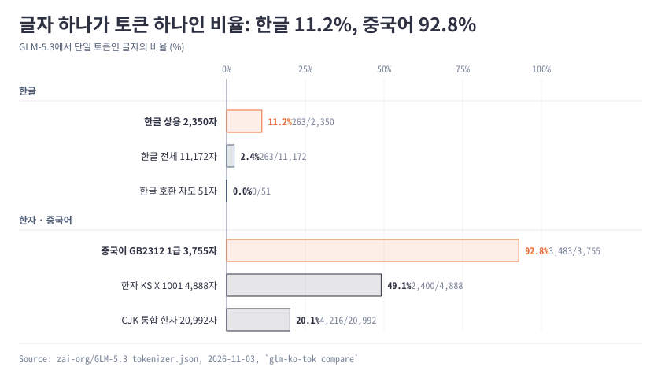
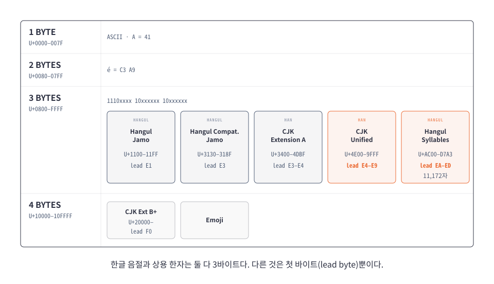
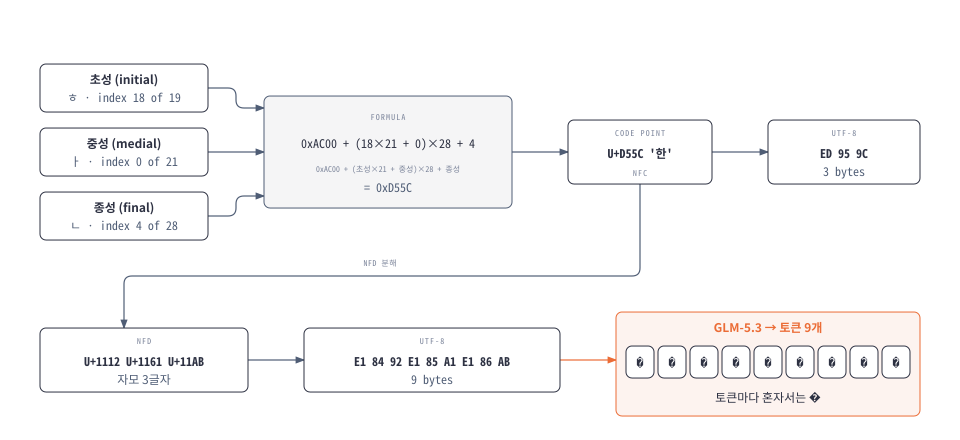
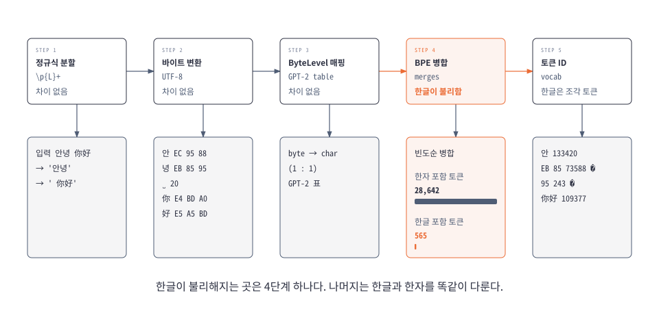
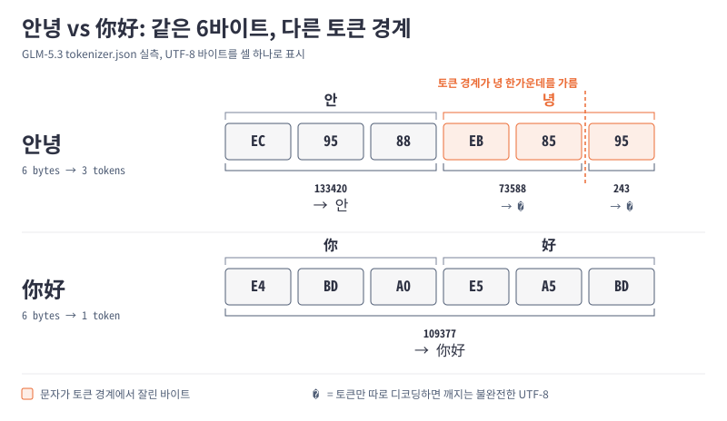

# 한글은 토큰이 잘게 쪼개진다: GLM-5.3, DeepSeek, Kimi 비교

## 답

세 모델 모두 한자에 치우쳐 있다. 상용 한자는 93–98%가 토큰 하나지만, 상용 한글은 10–17%만 토큰 하나다.
원인은 바이트 수가 아니라 어휘(vocab)다. 한글과 한자는 UTF-8에서 둘 다 3바이트다.
화면의 `�`는 토크나이저 버그가 아니다. 토큰을 하나씩 따로 문자열로 바꾸는 계층에서 생긴다.
OpenRouter와 omp로 실제로 돌려 본 결과, 짧은 세션에서는 `�`도 화면 깨짐도 재현되지 않았다 (6절).

<picture>
  <source media="(prefers-color-scheme: dark)" srcset="diagrams/coverage-bar-dark.svg">
  
</picture>

## 1. 한글과 한자는 둘 다 3바이트다

UTF-8 바이트 수는 코드포인트(유니코드 번호) 크기로만 정해진다.
한글 음절(U+AC00–D7A3)과 상용 한자(U+4E00–9FFF)는 같은 3바이트 구간에 있다. 다른 것은 첫 바이트뿐이다.

<picture>
  <source media="(prefers-color-scheme: dark)" srcset="diagrams/utf8-blocks-dark.svg">
  
</picture>

블록별 범위와 첫 바이트

| 블록 | 범위 | 글자 수 | UTF-8 | 첫 바이트 |
|---|---|---:|---:|---|
| 한글 음절 | U+AC00–U+D7A3 | 11,172 | 3 | `EA`–`ED` |
| 한글 자모 (조합용, NFD) | U+1100–U+11FF | 256 | 3 | `E1` |
| 한글 호환 자모 (ㄱ, ㅏ) | U+3130–U+318F | 94 | 3 | `E3` |
| 한글 자모 확장 A / B (옛한글) | U+A960–U+A97F, U+D7B0–U+D7FF | 29 + 72 | 3 | `EA`, `ED` |
| CJK 통합 한자 | U+4E00–U+9FFF | 20,992 | 3 | `E4`–`E9` |
| CJK 통합 한자 확장 A | U+3400–U+4DBF | 6,592 | 3 | `E3`–`E4` |
| CJK 통합 한자 확장 B 이후 | U+20000– | 수만 자 | 4 | `F0` |
| CJK 호환 한자 | U+F900–U+FAFF | 472 | 3 | `EF` |

출처: [Unicode Character Code Charts](https://www.unicode.org/charts/).

## 2. 한글 음절은 자모를 계산식으로 합친 번호다

음절 번호는 `0xAC00 + (초성 × 21 + 중성) × 28 + 종성`이다. `한`은 U+D55C, 3바이트다.
같은 글자를 자모로 풀어 쓴 NFD 형태는 9바이트가 되고, GLM-5.3은 이것을 토큰 9개로 쪼갠다.
macOS 파일 이름이나 일부 복사·붙여넣기에서 NFD 한글이 들어온다.

<picture>
  <source media="(prefers-color-scheme: dark)" srcset="diagrams/hangul-compose-dark.svg">
  
</picture>

## 3. 한글 비용은 정규식이 아니라 병합 규칙이 정한다

세 토크나이저는 모두 byte-level BPE다. 글자를 바이트로 바꾼 뒤, 학습 데이터에서 자주 나온 바이트 쌍부터 합친다.
한글이 불리해지는 곳은 이 병합 단계 하나다.

<picture>
  <source media="(prefers-color-scheme: dark)" srcset="diagrams/tokenizer-pipeline-dark.svg">
  
</picture>

DeepSeek와 Kimi는 단어를 나누는 정규식에서 한자를 따로 떼어 낸다. 한글 범위는 세 모델 모두 없다.
그런데 한자 범위가 있는 DeepSeek가 한글을 가장 잘 다룬다. 정규식이 아니라 어휘 안의 한글 토큰 수가 결과를 정한다.

| 모델 | 정규식의 한자 처리 | 한글 토큰 / 한자 토큰 | 한글 상용 1토큰 |
|---|---|---:|---:|
| GLM-5.3 | 없음 (`\p{L}`로 동일 처리) | 565 / 28,642 | 11.2% |
| DeepSeek-V4.1-Flash | `[一-龥぀-ゟ゠-ヿ]+` (한자, 가나) 분리 | 1,131 / 35,346 | 16.7% |
| Kimi-K3 | `[\p{Han}]+` 분리 | 515 / 69,464 | 10.1% |

"중국어 유니코드에만 최적화되어 한글과 매칭이 안 된다"는 말은 결과로는 맞고 원인으로는 틀리다.

## 4. '녕'은 세 모델 모두에서 글자 중간이 잘린다

'안녕'의 '녕'(`EB 85 95`)은 세 모델 모두 `EB 85`와 `95` 두 토큰으로 갈린다. 두 토큰은 혼자서는 올바른 UTF-8이 아니다.
'你好'는 세 모델 모두 6바이트가 토큰 하나다.

<picture>
  <source media="(prefers-color-scheme: dark)" srcset="diagrams/byte-split-dark.svg">
  
</picture>

한국 한자도 갈린다. `大韓民國`의 `韓`은 GLM-5.3과 Kimi-K3에서 `E9 9F` | `93`으로 잘린다. DeepSeek는 `韓`과 `民國`이 온전한 토큰이다.

## 5. `�`는 토큰을 하나씩 디코딩할 때만 생긴다

`samples/korean.txt` 36문장으로 스트리밍을 흉내 냈다. 토큰마다 따로 디코딩하면 세 모델 모두 `�`가 수백 개 나온다.
바이트를 모았다가 디코딩하면 세 모델 모두 `�`가 0개이고 원문과 같다.

| 모델 | 토큰마다 디코딩: `�` | 모았다가 디코딩: `�` |
|---|---:|---:|
| GLM-5.3 | 223 | 0 |
| DeepSeek-V4.1-Flash | 153 | 0 |
| Kimi-K3 | 235 | 0 |

깨짐이 생길 수 있는 지점은 네 곳이다. 각 지점은 다른 로그로 가려낸다.

| 지점 | 확인 방법 | 이 지점이 원인일 때 | 2026-11-03 실측 |
|---|---|---|---|
| 서빙 (vLLM, OpenRouter 제공자) | `glm-ko-tok probe`로 원본 SSE 저장 | 원본에 이미 `EF BF BD`가 있다 | 제공자 9곳 모두 0개 |
| 네트워크 청크 경계 | probe가 경계에서 잘린 글자를 센다 | 잘린 글자가 있다. 이것만으로는 깨지지 않는다 | 0개 |
| omp 바이트 디코딩 | `PI_REQ_DEBUG=1`로 omp가 받은 응답 저장 | 응답은 정상, omp 출력에만 `�` | 세션·파일 모두 0개 |
| omp 화면 렌더링 | `PI_TUI_WRITE_LOG`로 터미널에 쓴 텍스트 저장 | 로그는 정상, 화면만 깨진다 | 61칸·120칸 모두 정상 |

## 6. OpenRouter와 omp 실측에서는 깨짐이 재현되지 않았다

2026-11-03에 `z-ai/glm-5.3`(OpenRouter)과 omp 18.15.0으로 네 지점을 모두 실제로 돌렸다. 어느 지점에서도 `�`가 나오지 않았다.
전체 절차, 실행별 수치, 양성 대조, 재현 스크립트는 [시험 보고서](omp-openrouter-probe-report.md)에 있다.

서빙 쪽은 기본 라우팅(chat, responses)과 제공자 8곳 고정에서 원본 `EF BF BD`가 모두 0개였다.
Together에서는 네트워크 청크가 글자 중간을 자른 경우가 2번 있었지만 `�`는 0개였다. 청크 분할만으로는 깨지지 않는다.

omp 쪽은 한국어 docstring·주석·테스트 이름을 쓰는 코딩 작업과 61칸·120칸 TUI로 확인했다. 원본, 세션, 파일, 화면 모두 정상이었다.

대신 인코딩과 무관한 꼬임이 2건 나왔다. 모델이 omp edit 헤더에 파일 이름 대신 함수 이름(`greet.py`)을 썼고, 다른 실행에서는 docstring 한 줄을 15칸 들여썼다.
코딩 중 "코드가 꼬이는" 현상이 이런 종류라면, 원인은 글자 인코딩이 아니라 모델이 omp edit 형식을 다루는 방식이다.

판단 기준은 그대로다. 평범한 한글이 `�`로 나오면 서빙 쪽을 먼저 본다. 글자는 멀쩡한데 줄이 어긋나면 omp 렌더링 쪽이다.
'녕'은 세 모델에서 똑같이 잘리므로, GLM에서만 깨진다면 GLM을 서빙하는 제공자를 의심한다.

## 한계

이 문서는 토큰 수와 바이트 경계만 쟀다. 토큰이 많으면 비용과 컨텍스트를 더 쓰지만, 모델의 한국어 품질은 재지 않았다.
한국어·중국어 문장 비교는 직역 쌍이 아니므로 경향으로만 읽는다.
6절의 실측은 짧은 세션 몇 번뿐이다. 긴 세션이나 컨텍스트가 큰 상황에서만 생기는 문제는 잡지 못한다.
Kimi-K3 수치는 `tiktoken.model`과 공식 정규식으로 다시 구현해 쟀다. 공식 코드와의 ID 일치는 `RUN_REMOTE_CODE=1 uv run --group verify pytest -m remote_code`로 확인할 수 있고, 아직 실행하지 않았다.

## 다음 행동

1. 평소 omp를 쓸 때 로그를 켜 둔다: `PI_REQ_DEBUG=1 PI_TUI_WRITE_LOG=/tmp/omp-tui.log omp --model openrouter/z-ai/glm-5.3`. `PI_REQ_DEBUG`는 현재 디렉터리에 `rr-session-*.json`, `rr-session-*.res.log`를 쓴다.
2. 깨짐이 다시 보이면 그 세션의 `rr-session-*.res.log`, TUI 로그, 화면 캡처를 함께 남긴다.
3. 5절의 표로 원인 지점을 하나로 정하고, 그쪽에 이슈를 낸다.

원본 수치 (2026-11-03, <code>glm-ko-tok compare --model all</code>)

한 글자가 1/2/3토큰인 글자 수와 1토큰 비율:

| 문자 집합 | GLM-5.3 | DeepSeek-V4.1-Flash | Kimi-K3 |
|---|---|---|---|
| 한글 상용 2,350 | 263 / 1,337 / 750 (11.2%) | 392 / 1,362 / 596 (16.7%) | 237 / 1,249 / 864 (10.1%) |
| 한글 전체 11,172 | 263 / 5,653 / 5,256 (2.4%) | 392 / 6,190 / 4,590 (3.5%) | 237 / 5,159 / 5,776 (2.1%) |
| 한글 호환 자모 51 | 0 / 51 / 0 (0%) | 0 / 51 / 0 (0%) | 0 / 15 / 36 (0%) |
| 중국어 GB2312 1급 3,755 | 3,483 / 272 / 0 (92.8%) | 3,593 / 162 / 0 (95.7%) | 3,692 / 63 / 0 (98.3%) |
| 한자 KS X 1001 4,888 | 2,400 / 2,147 / 341 (49.1%) | 3,144 / 1,470 / 274 (64.3%) | 2,568 / 2,000 / 320 (52.5%) |
| CJK 통합 한자 20,992 | 4,216 / 15,901 / 875 (20.1%) | 5,246 / 15,619 / 127 (25.0%) | 4,919 / 15,379 / 694 (23.4%) |

어휘와 샘플 비용:

| 항목 | GLM-5.3 | DeepSeek-V4.1-Flash | Kimi-K3 |
|---|---:|---:|---:|
| 어휘 크기 (추가 토큰 포함) | 154,856 | 129,280 | 163,584 |
| 혼자서는 UTF-8이 아닌 토큰 | 1,095 | 1,470 | 1,172 |
| 한국어 샘플 36문장 토큰 수 | 483 | 428 | 480 |
| 한국어 글자당 토큰 | 1.11 | 0.98 | 1.10 |
| 같은 뜻 문장 3쌍: 한국어 글자당 토큰 | 1.15 | 0.92 | 1.19 |
| 같은 뜻 문장 3쌍: 중국어 글자당 토큰 | 0.70 | 0.70 | 0.70 |

고정 리비전: `zai-org/GLM-5.3@ba32f8c`, `deepseek-ai/DeepSeek-V4.1-Flash@314113f`, `moonshotai/Kimi-K3@f831ab6`.

